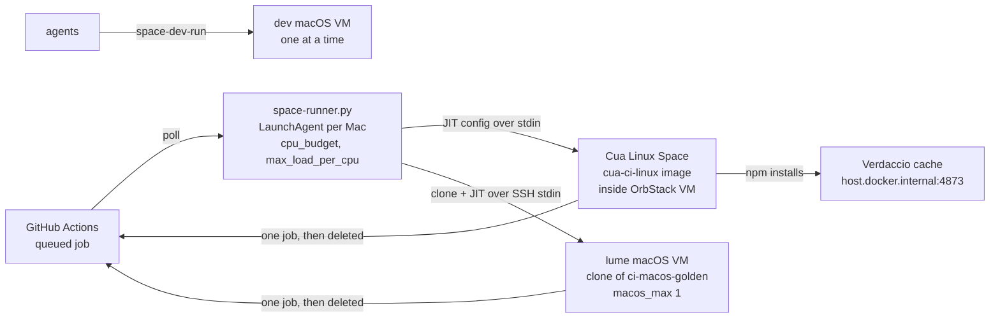
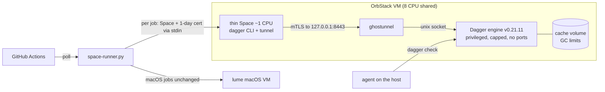

# Optional: local Mini Fleet CI (Spaces + Dagger)

A repo built from this template runs its CI on GitHub-hosted runners. This page
describes an optional alternative: run the Linux (and macOS) jobs on a small
fleet of your own Macs. Adopt it only when hosted minutes, private-repo limits
or queue time cost more than looking after the machines.

The example fleet is two Macs, a 12-core Mac Studio (96 GiB) and a 12-core Mac
mini (64 GiB), serving four private repos. Paths, hostnames and pool names below
are that fleet's; replace them with your own.

Part 1 is the setup in use today. Part 2 is a proposed Dagger layer on top of
it, with the measurements taken so far. Every number comes from a measurement
file named beside it. Rows marked **Pending (proof running)** are still being
measured.

## 1. Today: the Spaces runner

### How a job runs

1. A per-Mac controller (`space-runner.py`, a user LaunchAgent) polls GitHub
   every `poll_seconds` for queued jobs whose `runs-on` labels match one of its
   pools (`cua-linux` or `cua-macos` plus pool labels).
2. For each job without a waiting runner it creates one throwaway
   environment, asks GitHub for a single-use runner
   (`POST repos/<repo>/actions/runners/generate-jitconfig`) and starts the
   runner inside it. The JIT config travels over stdin, so it stays out of
   `argv` and off the host disk.
3. GitHub hands that runner exactly one job. When the runner exits, or sits
   unassigned for `idle_minutes` (5), or passes `job_hours` (7), the
   controller deletes the environment and the runner registration.

Linux jobs run in a **Cua Linux Space**: a container from a pinned local image
(`cua-ci-linux:<n>`, every download SHA-256 checked) inside OrbStack. macOS jobs
run in a **lume VM** cloned copy-on-write from a stopped golden image
(`ci-macos-golden`, Xcode and tools baked in, privacy prompts pre-denied).
Each job gets a fresh machine, and job code stays off the host.

### Controller limits (per Mac `config.json`, shared `pools.json`)

| Setting | Example value | Effect |
| --- | --- | --- |
| `allowed_repos` | 5 repos | Only these repos get runners; a pool for any other repo stops config loading. |
| `capacity.<pool>` | `cpus`, `memory_gb`, `max_spaces` | Each Mac's share of a pool. A pool with no entry is served elsewhere. |
| `cpu_budget` | 8 on both Macs | CPUs for all CI Spaces and VMs together, so 4 of 12 cores stay free for agents. |
| `max_load_per_cpu` | 2.0 | The controller starts nothing while the 5-minute load average per core is higher. |
| `max_spaces` | Studio 4, mini 2 | Ceiling on concurrent CI environments per Mac. |
| `macos_max` | 1 | CI uses one of the two macOS VMs Apple allows per Mac; agents use the other. |
| `min_queue_seconds` | mini 90 | The mini acts as overflow: it takes a job once the job has queued this long. A dedicated pool sets 0. |
| `idle_minutes`, `job_hours` | 5, 7 | Tear down an unused runner, and cap one job's lifetime. |
| `job_env` | npm and Bun registry URLs | Written to the runner's `.env`, so every job installs through the local cache. |

Jobs start round-robin across pools, oldest first within a pool, with pools
that have fewer running jobs first. A job that exceeds the remaining CPU budget
is skipped for this poll, so one large backlog leaves the other pools moving.

The controller re-reads `config.json` and `pools.json` every poll, so capacity
changes apply live. `host`, `poll_seconds` and the time limits are read at
start; change those with `safe-restart.sh`, which closes every pool, waits until
no CI environment is left, restarts the LaunchAgent and reopens the pools. A
plain `launchctl kickstart -k` can kill a runner at the moment it takes a job.

### Supporting pieces

- **npm cache.** A read-only Verdaccio (`ci-npm-cache`) on `127.0.0.1:4873`,
  reached from Spaces as `host.docker.internal:4873`. Nothing can be published
  into it.
- **`space-dev-run` for agents.** One command in a throwaway macOS VM cloned
  from the CI golden image. It holds a lock (one dev VM at a time), leaves CI's
  macOS slot free, waits while load is high, copies only a filtered file list
  (credentials and key-shaped files excluded) and always deletes the clone.
- **The controller runs under `taskpolicy -c utility`**, so agents on the same
  Mac keep priority.

### Lessons from running it

- **Wait for the Linux engine after a reboot.** After the Studio rebooted on
  29 Oct the controller and the Cua daemon started before OrbStack. Cua fell
  back to its built-in runtime, which lacks the CI image, and every Space create
  failed on a 404 pull for about half an hour. The controller now checks that
  the Docker socket answers and that Cua routes Linux Spaces to OrbStack before
  it creates one, and backs off (15 s doubling to 5 min) until both hold
  (`engine_problem()`, covered by `test_space_runner.py`).
- **Plan for login.** The controller is a per-user LaunchAgent
  (`RunAtLoad`, `KeepAlive`), so it starts when that user's session starts.
  Give a headless CI Mac automatic login, as the golden macOS image has.
- **Restart through the drain script** (`safe-restart.sh`), as above.

### Rules for this setup

- Run anything that touches input, windows or the display inside a Space or VM,
  so the host's keyboard, mouse and screen stay the user's.
- Check load before heavy work (`sysctl -n vm.loadavg` against
  `sysctl -n hw.ncpu`); the controller's `max_load_per_cpu` applies the same
  rule to CI.
- Keep a CPU and memory cap on every environment CI starts, and keep the sum
  inside `cpu_budget`.

## 2. Proposed: a shared Dagger engine per Mac

Today every Linux job starts from an empty Space and repeats its installs and
builds. The proposal keeps the Space as the per-job boundary but moves the
work into one long-lived, capped Dagger engine per Mac, whose cache survives
between jobs.

- **Engine.** One Dagger engine (v0.21.11) per Mac, inside OrbStack, with
  explicit `--cpus` and `--memory` caps and a GC policy on its cache volume. It
  runs privileged (Dagger needs that for its own containers) and publishes no
  ports. `insecureRootCapabilities` is false.
- **Access.** The engine's unix socket is shared only with a ghostunnel
  container, which listens on `127.0.0.1:8443` and requires a client certificate
  signed by a local CA with the expected CN.
- **Thin Spaces as clients.** Each job still gets a throwaway Space, now about
  1 CPU, holding only the Dagger CLI and a small TLS forwarder. The host mints
  a 1-day client certificate per job and streams it into the Space over stdin
  (written under `/run` with `umask 077`, gone when the Space is deleted), so it
  stays out of `argv`.
- **Secrets** reach the engine as Dagger secret references
  (`env://GITHUB_TOKEN`), kept out of Spaces, `argv` and cached command lines.
- **Agents** run the same module checks (`dagger check`) before they push, so
  local and CI runs share one definition and one cache.
- **macOS stays on lume.** The proposal covers Linux jobs only.

Known limits of the proof (from the proof's `PROGRESS.md` and `REPORT.md`):

- **Shared identity.** Every job certificate carries the same CN; the job name
  sits in `OU`, which ghostunnel leaves unchecked today. Bind certificates to a
  pool (match `OU` too) before real jobs use the engine.
- **Shared cache.** All repos on a Mac share one cache, which is the source of
  the speed-up. Keep it to first-party repos; give untrusted forks their own
  engine.
- **The network is open to any container on the Mac** through
  `host.docker.internal`, so the client certificate is the only gate.
- **One engine per Mac is a single point of failure** for that Mac's Linux jobs.

### Resource map

| | Studio | mini |
| --- | --- | --- |
| Host | 12 cores, 96 GiB | 12 cores, 64 GiB |
| OrbStack VM (Linux Spaces and the engine) | 8 CPU, 48 GiB | 8 CPU, 16 GiB |
| macOS VMs (lume, outside OrbStack) | 4 CPU / 8 to 12 GiB, `macos_max` 1 | 4 CPU / 8 GiB, `macos_max` 1 |
| Engine under test | 6 CPU, 16 GiB, GC 80 GB | 6 CPU, 8 GiB, GC 40 GB |
| Engine cache after the proof runs | 59.1 GB | 24.2 GB |

Three facts drive the split:

1. Linux Spaces and the engine share the same 8 OrbStack CPUs, and
   `cpu_budget` 8 already equals that allowance. An engine added without
   lowering `cpu_budget` oversubscribes the VM.
2. `cpu_budget` counts only Spaces the controller started
   (`allocate()` sums `slots`). The engine shows up only in
   `max_load_per_cpu`, which lags by minutes.
3. On the mini, an 8 GiB engine plus one 8 GiB Space equals the 16 GiB OrbStack
   ceiling, with zero headroom.

| Split | Shape | Gains | Costs |
| --- | --- | --- | --- |
| (a) Thin Spaces, engine takes most of the budget | Engine gets most of the 8 OrbStack CPUs; thin Spaces of about 1 CPU | Most jobs per Mac; warm cache for every job | Engine is the bottleneck and a single point of failure |
| (b) Fixed engine share, fewer full Spaces | Engine gets a fixed share; some 2 to 4 CPU Spaces kept | Jobs that gain little from the cache keep today's path | Less room for both; two paths to maintain |
| (c) Studio for macOS, mini runs the engine | One engine, on the mini | One cache to manage | The mini's 16 GiB VM is the ceiling; Studio Linux jobs cross machines |
| (d) Engine on both Macs | One engine per Mac | Each Mac keeps its own warm cache; a failed engine stops only its own Mac | Two caches to fill and GC |

Source for the map: the proof's `PROGRESS.md` (13:38 entry).

Recommended engine caps, cache limit, thin Space size, jobs per Mac and the
`cpu_budget` adjustment: **Pending (proof running).** They need the burst
results.

## 3. Metrics

Percentiles are nearest-rank; with n = 5 the p90 is the maximum. Status-quo
replays ran in a fresh 2 CPU / 6 GB Space on the Studio (4 CPU / 12 GB for the
monorepo). Dagger runs called the mini's engine (6 CPU / 8 GiB) from the host
over `container://`, so they exclude thin Space and mTLS time.
The hardware differs, so compare shapes, and wait for the same-hardware rows
before comparing seconds. Source: `bench/results/{sq,dg}.csv` on each Mac,
tabulated by `bench/report_tables.py`.

### Per job: status quo vs Dagger (seconds, median / p90, n)

| Job | Status quo | Dagger cold | Dagger warm | Dagger one-file change |
| --- | --- | --- | --- | --- |
| Policy check (small) | 1.3 / 8.1, n 5 | 47.2 / 79.8, n 5 | 0.6 / 0.6, n 5 | 3.2 / 19.1, n 5 |
| Library verify | 346.5 / 485.4, n 5 | 180.6 / 241.6, n 5 | 0.6 / 1.2, n 5 | Pending (proof running) |
| Fixture tests | 25.7 / 37.7, n 5 | 67.1 / 69.8, n 5 | 0.5 / 2.4, n 5 | 16.2 / 18.9, n 5 |
| Site build and test | 139.5 / 199.9, n 5 | 213.9 / 229.2, n 5 | 0.5 / 0.6, n 5 | 57.4 / 94.5, n 5 |
| Monorepo PR gates | 368.0, n 1 (12 of 13 gates pass) | Pending (proof running) | Pending (proof running) | Pending (proof running) |

- Warm runs were full cache hits (cache-hit ratio 1.00); cold and change runs
  had none.
- Status-quo times exclude Space creation (median 0.3 to 7.7 s) and source
  upload (median 1.9 to 27.6 s).
- Library verify change runs failed with rc 1 as designed: the edit touched
  `src/` without rebuilding `dist/`, and the repo's dist-sync gate caught it.
  The rerun edits a test file instead.
- Engine memory peaked at 3,928 MiB (library verify, cold) and 4,243 MiB (site,
  change).
- Same-hardware status-quo rows on the mini: Pending (proof running).

### Burst baseline: real queue on 29 Oct

One repo's CI on a single runner, from `inventory/bp_burst_2026-10-29.json`
(`burst_hist.py` and `hist_subset.py`):

| | Whole burst | Replay subset |
| --- | --- | --- |
| Job records | 89 (7 workflows' runs) | 49 (7 runs, 7 jobs each) |
| Ran on a runner | 48 | 27 (22 cancelled while queued) |
| Queue, median / p90 (s) | 1778 / 7821 | 2665 / 7821 |
| Makespan | 262.6 min | 249.4 min |
| Busy runner time | 41.3 min | 35.1 min |
| Peak concurrency | 1 | 1 |

The runner was busy for 41 of 263 minutes. The queue, not the work, set the
time to green.

| Replay | Jobs/hour | Queue median / p90 | Makespan | Peak load per CPU |
| --- | --- | --- | --- | --- |
| Status quo, full Spaces | Pending (proof running) | Pending (proof running) | Pending (proof running) | Pending (proof running) |
| Dagger, thin Spaces | Pending (proof running) | Pending (proof running) | Pending (proof running) | Pending (proof running) |

### Engine access proof

| Check | Result | Source |
| --- | --- | --- |
| Thin Space (1 CPU) ready | 5.85 s, n 1 | proof `BRIEF.md` |
| Thin Space without a client certificate | Refused by ghostunnel | proof `BRIEF.md`, `REPORT.md` |
| Listener scope | `127.0.0.1:8443` only, on both Macs | proof `PROGRESS.md` |
| Engine container | Privileged, no published ports | proof `PROGRESS.md` |
| Two-job smoke burst (mini, 0.5 CPU / 1 GB thin Spaces) | Space ready 7.4 s; one job passed in 37.2 s; the other returned rc 1 against an expected 0 | `burst-smoke.json` |
| mTLS overhead against a host `container://` run | Pending (proof running) | |
