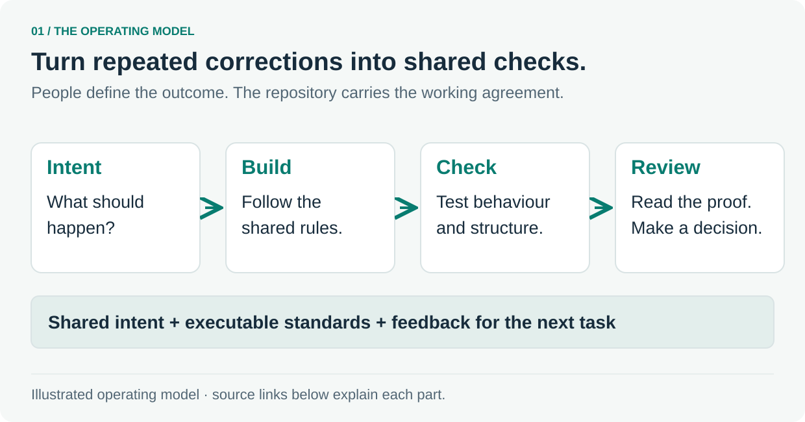

# A software factory, in seven steps

A fifteen-minute tour of how a repository can make agent-assisted engineering easier to trust and review. Each stop has one readable visual, a worked example and links to the source.

## Follow the tour

1. **[What makes a software factory?](tour/01-factory.md)**  
   What makes repeated corrections reusable?

2. **[Make the intended behaviour precise](tour/02-intent.md)**  
   What, exactly, should happen for the user?

3. **[Choose checks that catch real mistakes](tour/03-quality.md)**  
   Which mistakes will the checks catch?

4. **[Make architecture executable](tour/04-boundaries.md)**  
   Can the dependency rules be read and tested?

5. **[Put feedback where it helps](tour/05-feedback.md)**  
   Where should feedback arrive, and how is it protected?

6. **[Protect the standards themselves](tour/06-review.md)**  
   What does a person need to judge a change?

7. **[Review the change and improve the method](tour/07-improvement.md)**  
   Did the new rule or guidance actually help?

## Using the tour

Start with the first stop and use **Next** at the bottom of each page. The source links provide an optional closer look after the example is clear.

The visuals explain source examples or a labelled recommended approach. The linked tests show their assertions; run results and logs provide execution evidence for the revision you are reviewing.

[Start the tour →](tour/01-factory.md) · [Back to the repository](../README.md)
