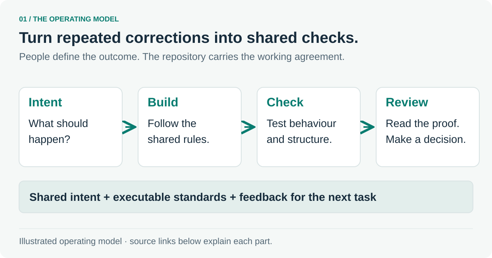

# 1. What makes a software factory?

Give engineers and agents a shared way to build, check and review a change.

A repository can carry more than source code. It can make product intent visible, express standards as checks and give the next person enough evidence to review the work.

The useful starting point is a recurring correction: an unclear requirement, a forbidden dependency or a test that misses an important consequence. Make that correction reusable, then see whether it reduces review work.

**Follow the source:** [Agent entry point](../../AGENTS.md) · [Project conventions](../../.agents/project/CONVENTIONS.md) · [PR quality contract](../../.agents/project/PR_QUALITY.md)

---

[Tour overview](../software-factory-tour.md) · [Next: Make the intended behaviour precise](02-intent.md)
