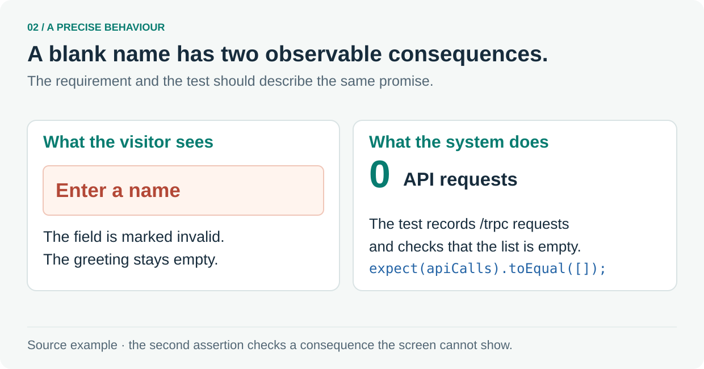

# 2. Make the intended behaviour precise

Follow one small promise from the product requirement to its assertions.



The [greeting requirement](../prd/greeting.md) says a blank name must show `Enter a name`, mark the field invalid and send the API zero requests.

The [browser test](../../apps/web/e2e/greeting.spec.ts#L33-L50) observes both the page and outgoing requests:

```ts
await expect(page.getByRole('alert')).toHaveText('Enter a name');
expect(apiCalls).toEqual([]);
```

These are two assertions from a larger test. The second assertion checks the unwanted side effect that the visible error alone would miss. The full test starts observing requests before submitting the blank name.

**Follow the source:** [Product requirement](../prd/greeting.md) · [Complete browser test](../../apps/web/e2e/greeting.spec.ts#L33-L50)

---

[Tour overview](../software-factory-tour.md) · [Previous: What makes a software factory?](01-factory.md) · [Next: Choose checks that catch real mistakes](03-quality.md)
