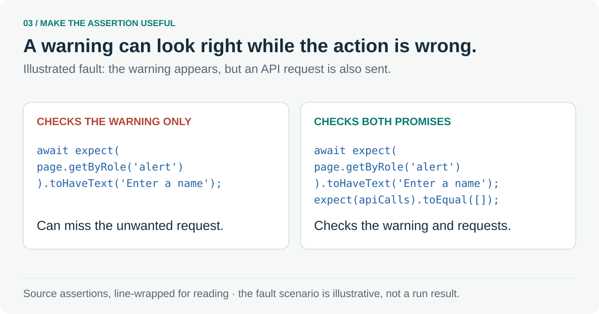

# 3. Choose checks that catch real mistakes

Check the unwanted consequence as well as the visible result.



The requirement makes two promises for a blank name: show `Enter a name` and send zero API requests. An implementation could display the right warning while still sending the request. That is the illustrated fault above.

A test that checks only the warning could pass that faulty implementation. The existing [browser test](../../apps/web/e2e/greeting.spec.ts#L33-L50) also records requests to `/trpc` and checks the list:

```ts
expect(apiCalls).toEqual([]);
```

That assertion matters because it checks a consequence that stays invisible to the visitor. A visible warning is evidence about the message; the request assertion checks whether the invalid action was stopped.

To test the test itself, deliberately introduce the unwanted request in a test copy and require a failure for that reason. Restore the sound version and require a pass. This is a proposed fault experiment, separate from reading the existing assertions.

The same discipline applies to source rules: exercise an allowed example as well as a violation, and choose rules that prevent a mistake the team cares about.

**Follow the source:** [Requirement](../prd/greeting.md) · [Complete browser test](../../apps/web/e2e/greeting.spec.ts#L33-L50) · [Optional: rejected and accepted type-rule examples](../../scripts/anti-slop-lint.test.ts#L66-L84)

---

[Tour overview](../software-factory-tour.md) · [Previous: Make the intended behaviour precise](02-intent.md) · [Next: Make architecture executable](04-boundaries.md)
