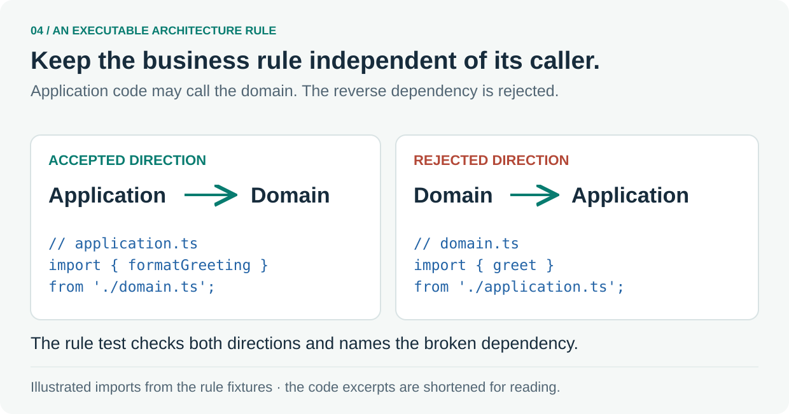

# 4. Make architecture executable

Use a small dependency rule that an audience can read at a glance.



The **domain** holds the business rule. The **application** coordinates work and calls that rule. Keeping this dependency pointed inward lets the business rule stay independent of its caller.

The [boundary fixtures](../../tooling/architecture/boundaries.test.ts) contain a valid greeting slice and a deliberate reversal. The invalid fixture makes `domain.ts` import `application.ts`; its expected finding is:

```text
boundary api-domain -> api-application
```

That finding names the dependency to repair. For side effects such as a remote call, the application coordinates an integration module while the domain keeps the rule itself.

**Follow the source:** [Valid fixture](../../tooling/architecture/boundaries.test.ts#L44-L54) · [Reversed dependency](../../tooling/architecture/boundaries.test.ts#L215-L225) · [Architecture roles](../../.agents/project/ARCHITECTURE.md)

---

[Tour overview](../software-factory-tour.md) · [Previous: Choose checks that catch real mistakes](03-quality.md) · [Next: Put feedback where it helps](05-feedback.md)
