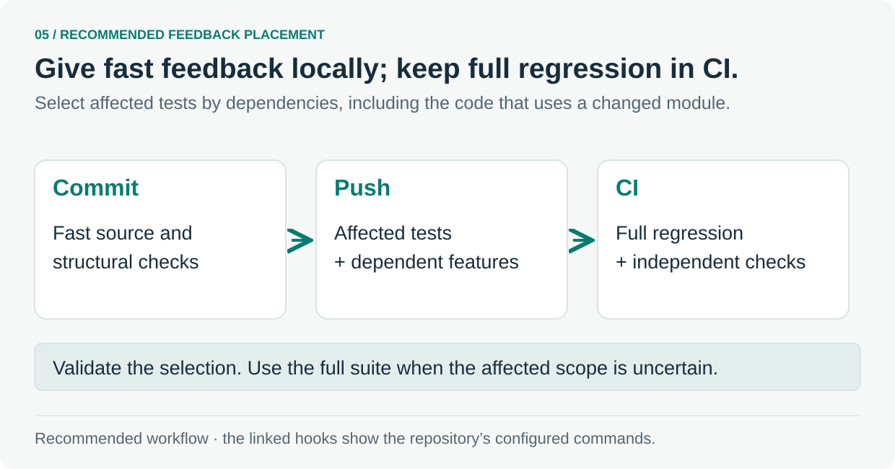

# 5. Put feedback where it helps

Keep the working loop quick and protect the checks that the team relies on.

The diagram is the recommended placement of checks. Read the linked hooks for the commands configured in this repository. A shared-module change must bring dependent features into the affected test selection; use the full suite when that scope is uncertain.

### Test the checking machinery

The [required-gates test](../../scripts/required-gates.test.ts#L365-L378) first checks the committed configuration. Another case makes a **test copy** of the workflow, removes its `pnpm lint:anti-slop` step and expects the validator to name the missing command.

The validator checks that the configuration contains the required command. A run result and its logs show what actually executed.

**Follow the source:** [Pre-commit hook](../../.husky/pre-commit) · [Pre-push hook](../../.husky/pre-push) · [Missing-command fixture](../../scripts/required-gates.test.ts#L365-L378) · [Required-gates inventory](../required-gates.md)

---

[Tour overview](../software-factory-tour.md) · [Previous: Make architecture executable](04-boundaries.md) · [Next: Protect the standards themselves](06-review.md)
