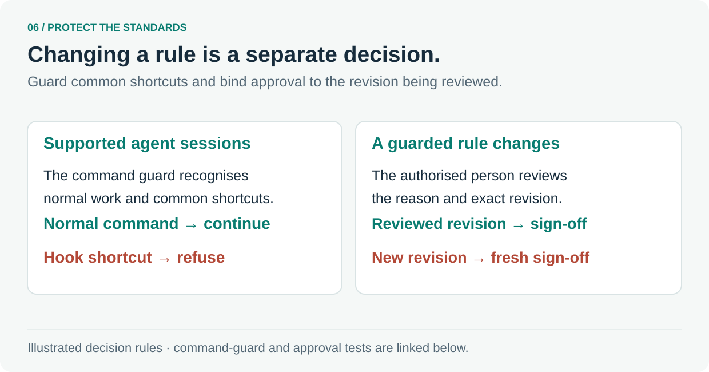

# 6. Protect the standards themselves

Keep rule changes deliberate and tied to an authorised human decision.

In supported agent sessions, the [command guard](../../.agents/hooks/block-gate-bypass.sh) checks shell commands before they run. Its [tests](../../scripts/block-gate-bypass.test.ts) include normal commands that continue and common hook shortcuts that are refused. Repository checks and hosted merge protections have their own jobs.

A proposal may weaken a guarded rule by switching it off or narrowing its scope. The [enforcement checker](../../scripts/enforcement-approval.mjs) compares the proposal with the existing standards. It uses the trusted default-branch implementation and binds sign-off to the authorised person and reviewed revision.

A new revision needs fresh sign-off. Product-intent changes also require a deliberate decision. A useful review explains why the rule or promise should change and shows the relevant tests.

**Follow the source:** [Command-guard tests](../../scripts/block-gate-bypass.test.ts) · [Approval rule](../../scripts/enforcement-approval.mjs) · [Approval tests](../../scripts/enforcement-approval.test.ts) · [PR quality contract](../../.agents/project/PR_QUALITY.md)

---

[Tour overview](../software-factory-tour.md) · [Previous: Put feedback where it helps](05-feedback.md) · [Next: Review the change and improve the method](07-improvement.md)
