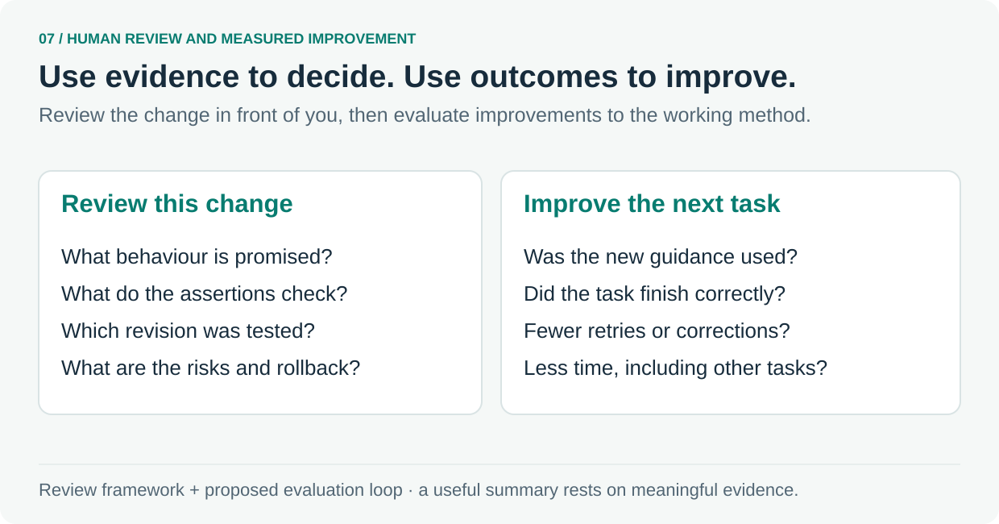

# 7. Review the change and improve the method

Make a human decision from meaningful evidence, then test improvements to the working method.

The [PR template](../../.github/pull_request_template.md) brings together the problem, intended behaviour, proof, revision, risk and rollback. The [confidence calculation](../../scripts/confidence-label.mjs) summarises check results, changed-code coverage and dependency impact. The reviewer still judges the meaning and sufficiency of that evidence.

A recorded lesson becomes useful when it changes later work. Make the proposed change small enough to evaluate: a clearer instruction, a focused test or an executable rule.

Compare equivalent tasks with and without the change. Check whether the agent encountered and used the guidance, then compare task success, repeated mistakes, human corrections and elapsed time. Include unrelated tasks to see whether the addition creates extra work elsewhere.

This is an evaluation approach to apply, rather than a claim of measured productivity gains in this repository. The repository's conventions, decision records and trial runbook provide places to explain and exercise a proposed improvement.

**Follow the source:** [PR template](../../.github/pull_request_template.md) · [Confidence calculation](../../scripts/confidence-label.mjs) · [Conventions](../../.agents/project/CONVENTIONS.md) · [Decision records](../../.agents/decisions/) · [Trial runbook](../../.agents/TRIALS.md)

**Choose one starting point:** which repeated correction should become easier on the next task?

---

[Tour overview](../software-factory-tour.md) · [Previous: Protect the standards themselves](06-review.md)
