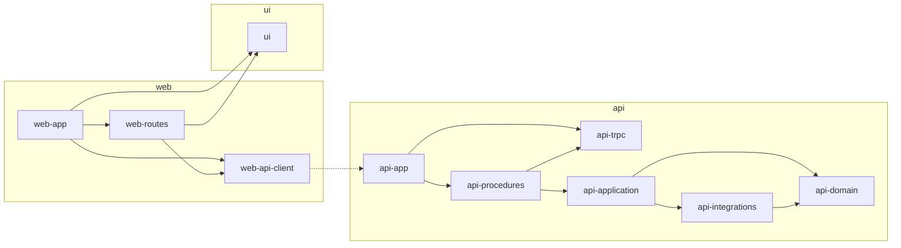
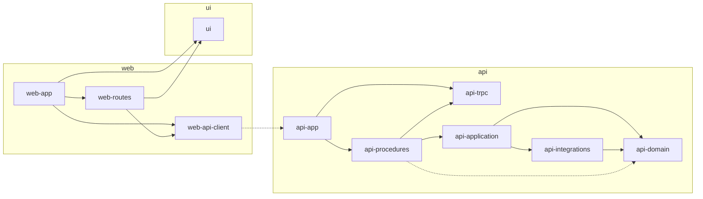

<!-- Generated by tooling/trial/compare.mjs (node tooling/trial/compare.mjs). Edit the generator, then regenerate. -->

# Todo trial comparison

This report compares the Todo trial results under ADR 0035: the full pass count, the shared baseline, and every aspect of five dimensions, each identical, inside a named spec freedom, or outside the spec.

## Verdict

- Full pass count 2/3
- `todo-01` failed only on `/tmp/verify.log`, which existed before its run; every run wrote logs under `/tmp` (see Runs).
- Consistency: `inconsistent`. 2 aspects sit outside the spec, 2 with an author's note; 4 sit inside a spec freedom, 4 by the script's rules and 0 by an author's ruling.
- Baseline: shared. All 13 baseline checks hold.

## Structure

| Aspect | `todo-01` | `todo-02` | `todo-03` | Classification |
| --- | --- | --- | --- | --- |
| `role web-app` | `present` | `present` | `present` | identical |
| `role web-api-client` | `present` | `present` | `present` | identical |
| `role web-routes` | `present` | `present` | `present` | identical |
| `role web-features` | `absent` | `absent` | `absent` | identical |
| `role ui` | `present` | `present` | `present` | identical |
| `role api-app` | `present` | `present` | `present` | identical |
| `role api-trpc` | `present` | `present` | `present` | identical |
| `role api-procedures` | `present` | `present` | `present` | identical |
| `role api-application` | `present` | `present` | `present` | identical |
| `role api-domain` | `present` | `present` | `present` | identical |
| `role api-integrations` | `present` | `present` | `present` | identical |
| `edge api-app --> api-procedures` | `present` | `present` | `present` | identical |
| `edge api-app --> api-trpc` | `present` | `present` | `present` | identical |
| `edge api-application --> api-domain` | `present` | `present` | `present` | identical |
| `edge api-application --> api-integrations` | `present` | `present` | `present` | identical |
| `edge api-integrations --> api-domain` | `present` | `present` | `present` | identical |
| `edge api-procedures --> api-application` | `present` | `present` | `present` | identical |
| `edge api-procedures -.-> api-domain` | `(absent)` | `(absent)` | `present` | outside the spec |
| `edge api-procedures --> api-trpc` | `present` | `present` | `present` | identical |
| `edge web-api-client -.-> api-app` | `present` | `present` | `present` | identical |
| `edge web-app --> ui` | `present` | `present` | `present` | identical |
| `edge web-app --> web-api-client` | `present` | `present` | `present` | identical |
| `edge web-app --> web-routes` | `present` | `present` | `present` | identical |
| `edge web-routes --> ui` | `present` | `present` | `present` | identical |
| `edge web-routes --> web-api-client` | `present` | `present` | `present` | identical |
| `files web-app` | `3` | `3` | `3` | identical |
| `files web-api-client` | `6` | `6` | `6` | identical |
| `files web-routes` | `8` | `8` | `8` | identical |
| `files web-features` | `0` | `0` | `0` | identical |
| `files ui` | `0` | `0` | `0` | identical |
| `files api-app` | `2` | `2` | `2` | identical |
| `files api-trpc` | `1` | `1` | `1` | identical |
| `files api-procedures` | `2` | `2` | `2` | identical |
| `files api-application` | `1` | `1` | `1` | identical |
| `files api-domain` | `1` | `1` | `1` | identical |
| `files api-integrations` | `1` | `1` | `1` | identical |
| `files outside-roles` | `9` | `9` | `9` | identical |
| `tests web-app` | `0` | `0` | `0` | identical |
| `tests web-api-client` | `2` | `2` | `2` | identical |
| `tests web-routes` | `3` | `2` | `3` | spec freedom 6 |
| `tests api-app` | `1` | `1` | `1` | identical |
| `tests api-trpc` | `0` | `0` | `0` | identical |
| `tests api-procedures` | `1` | `1` | `1` | identical |
| `tests api-application` | `1` | `1` | `1` | identical |
| `tests api-domain` | `1` | `1` | `1` | identical |
| `tests api-integrations` | `1` | `0` | `1` | spec freedom 6 |
| `tests outside-roles` | `0` | `0` | `0` | identical |
| `tests e2e` | `2` | `1` | `2` | spec freedom 6 |
| `file web/index.html` | `3c4143801c2a` | `3c4143801c2a` | `3c4143801c2a` | identical |
| `file web/vite.config.ts` | `0002d92d5d0d` | `0002d92d5d0d` | `0002d92d5d0d` | identical |

Written forms where the runs differ:

- `tests web-routes`: `todo-01` `web/src/routes/todos/TodosPage.test.tsx, web/src/routes/todos/todoFormSchema.test.ts, web/src/routes/todos/useTodos.test.tsx`; `todo-02` `web/src/routes/todos/TodosPage.test.tsx, web/src/routes/todos/todoFormSchema.test.ts`; `todo-03` `web/src/routes/todos/TodosPage.test.tsx, web/src/routes/todos/todoFormSchema.test.ts, web/src/routes/todos/useTodos.test.tsx`
- `tests api-integrations`: `todo-01` `api/src/features/todos/integrations.test.ts`; `todo-02` `(none)`; `todo-03` `api/src/features/todos/integrations.test.ts`
- `tests e2e`: `todo-01` `web/e2e/accessibility.spec.ts, web/e2e/todos.spec.ts`; `todo-02` `web/e2e/todos.spec.ts`; `todo-03` `web/e2e/accessibility.spec.ts, web/e2e/todos.spec.ts`

## Public API

| Aspect | `todo-01` | `todo-02` | `todo-03` | Classification |
| --- | --- | --- | --- | --- |
| `operations` | holds | holds | holds | identical |
| `item shape` | holds | holds | holds | identical |
| `item id type` | `string` | `string` | `string` | identical |
| `list input` | `void` | `void` | `void` | identical |
| `list output` | `Item[]` | `Item[]` | `Item[]` | identical |
| `create input` | `{ title: string }` | `{ title: string }` | `{ title: string }` | identical |
| `create output` | `Item` | `Item` | `Item` | identical |
| `toggle input` | `{ id: Id }` | `{ id: Id }` | `{ id: Id }` | identical |
| `toggle output` | `Item` | `Item` | `Item` | identical |
| `delete input` | `{ id: Id }` | `{ id: Id }` | `{ id: Id }` | identical |
| `delete output` | `{ id: Id }` | `{ id: Id }` | `{ id: Id }` | identical |
| `exports api:api-app` | `AppRouter type, appRouter value` | `AppRouter type, appRouter value` | `AppRouter type, appRouter value` | identical |
| `exports api:api-procedures` | `value 1 · type 0` | `value 1 · type 0` | `value 1 · type 0` | identical |
| `exports web:web-api-client` | `ApiProvider value, RouterInputs type, RouterOutputs type, TestApiHandlers type, TestApiProvider value, useTrpc value` | `ApiProvider value, RouterOutputs type, TestApiHandlers type, TestApiProvider value, useTrpc value` | `ApiProvider value, RouterInputs type, RouterOutputs type, TestApiHandlers type, TestApiProvider value, useTrpc value` | outside the spec |
| `exports web:web-routes` | `value 1 · type 0` | `value 1 · type 0` | `value 1 · type 0` | identical |

Written forms where the runs differ:

- `delete output`: `todo-01` `{ id: string; }`; `todo-02` `TodoRequest`; `todo-03` `{ readonly id: string; }`

## Dependencies

| Aspect | `todo-01` | `todo-02` | `todo-03` | Classification |
| --- | --- | --- | --- | --- |
| `web dependencies @hookform/resolvers` | `^5.9.1` | `^5.9.1` | `^5.9.1` | identical |
| `web dependencies @repo/ui` | `workspace:*` | `workspace:*` | `workspace:*` | identical |
| `web dependencies @tanstack/react-query` | `^5.104.3` | `^5.104.3` | `^5.104.3` | identical |
| `web dependencies @trpc/client` | `^11.19.0` | `^11.19.0` | `^11.19.0` | identical |
| `web dependencies @trpc/server` | `^11.19.0` | `^11.19.0` | `^11.19.0` | identical |
| `web dependencies @trpc/tanstack-react-query` | `^11.19.0` | `^11.19.0` | `^11.19.0` | identical |
| `web dependencies effect` | `^3.22.3` | `^3.22.3` | `^3.22.3` | identical |
| `web dependencies react` | `^19.1.0` | `^19.1.0` | `^19.1.0` | identical |
| `web dependencies react-dom` | `^19.1.0` | `^19.1.0` | `^19.1.0` | identical |
| `web dependencies react-hook-form` | `^7.90.0` | `^7.90.0` | `^7.90.0` | identical |
| `web devDependencies @{id}/api` | `workspace:*` | `workspace:*` | `workspace:*` | identical |
| `web devDependencies @vitejs/plugin-react` | `^4.3.4` | `^4.3.4` | `^4.3.4` | identical |
| `web devDependencies vite` | `^6.0.7` | `^6.0.7` | `^6.0.7` | identical |
| `web manifest` | `{"name":"@{id}/web","private":true,"scripts":{"build":"vite build","dev":"vite","preview":"vite preview --port 3000"},"type":"module","version":"0.1.0"}` | `{"name":"@{id}/web","private":true,"scripts":{"build":"vite build","dev":"vite","preview":"vite preview --port 3000"},"type":"module","version":"0.1.0"}` | `{"name":"@{id}/web","private":true,"scripts":{"build":"vite build","dev":"vite","preview":"vite preview --port 3000"},"type":"module","version":"0.1.0"}` | identical |
| `api dependencies @trpc/server` | `^11.19.0` | `^11.19.0` | `^11.19.0` | identical |
| `api dependencies effect` | `^3.22.3` | `^3.22.3` | `^3.22.3` | identical |
| `api manifest` | `{"exports":{".":{"types":"./src/router.ts"}},"name":"@{id}/api","private":true,"scripts":{"dev":"node --watch src/server.ts","start":"node src/server.ts"},"type":"module","version":"0.1.0"}` | `{"exports":{".":{"types":"./src/router.ts"}},"name":"@{id}/api","private":true,"scripts":{"dev":"node --watch src/server.ts","start":"node src/server.ts"},"type":"module","version":"0.1.0"}` | `{"exports":{".":{"types":"./src/router.ts"}},"name":"@{id}/api","private":true,"scripts":{"dev":"node --watch src/server.ts","start":"node src/server.ts"},"type":"module","version":"0.1.0"}` | identical |

## Component boundaries

| Aspect | `todo-01` | `todo-02` | `todo-03` | Classification |
| --- | --- | --- | --- | --- |
| `page` | holds | holds | holds | identical |
| `ui controls` | holds | holds | holds | identical |
| `feature component roles` | holds | holds | holds | identical |
| `components web-api-client` | `props(value) ui() raw() calls() ; props(value,value) ui() raw() calls(use*)` | `props(value) ui() raw() calls() ; props(value,value) ui() raw() calls(use*)` | `props(value) ui() raw() calls() ; props(value,value) ui() raw() calls(use*)` | identical |
| `components web-app` | `props() ui() raw() calls()` | `props() ui() raw() calls()` | `props() ui() raw() calls()` | identical |
| `components web-routes` | `props() ui() raw() calls(use*) ; props(fn/1) ui(Button,TextField) raw() calls(use*) ; props(fn/1,fn/1,value) ui() raw() calls() ; props(fn/1,fn/1,value) ui(Button) raw(input:checkbox) calls()` | `props() ui() raw() calls(use*) ; props(fn/1) ui(Button,TextField) raw() calls(use*) ; props(fn/1,fn/1,value) ui() raw() calls() ; props(fn/1,fn/1,value) ui(Button) raw(input:checkbox) calls()` | `props() ui() raw() calls(use*) ; props(fn/1) ui(Button,TextField) raw() calls(use*) ; props(fn/1,fn/1,value) ui() raw() calls() ; props(fn/1,fn/1,value) ui(Button) raw(input:checkbox) calls()` | identical |

## Conventions

| Aspect | `todo-01` | `todo-02` | `todo-03` | Classification |
| --- | --- | --- | --- | --- |
| `server state` | holds | holds | holds | identical |
| `one form` | holds | holds | holds | identical |
| `local state` | holds | holds | holds | identical |
| `storage role` | holds | holds | holds | identical |
| `hooks web-api-client` | `calls(useState)` | `calls(useState)` | `calls(useState)` | identical |
| `hooks web-routes` | `calls(effectTsResolver,useForm) ; calls(useMutation,useMutation,useMutation,useQuery,useQueryClient,useTrpc)` | `calls(effectTsResolver,useForm) ; calls(useMutation,useMutation,useMutation,useQuery,useQueryClient,useTrpc)` | `calls(effectTsResolver,useForm) ; calls(useMutation,useMutation,useMutation,useQuery,useQueryClient,useTrpc)` | identical |
| `id generation` | `randomUUID` | `counter` | `randomUUID` | spec freedom 3 |

## Runs

| Run | Status | Read from | Commit | Agent time | Checks (exit code) | Failure |
| --- | --- | --- | --- | --- | --- | --- |
| `todo-01` | **`failed`** | `docs/trials/todo-01.patch` | `bb00a14` | `8 min 15 s` | `install` `0`, `verify` `0`, `e2e` `0` and `structure` `0` | `named paths outside the clone: /tmp/verify.log` |
| `todo-02` | `passed` | `showcase/todo-02` | `feb8d22` | `9 min 0 s` | `install` `0`, `verify` `0`, `e2e` `0` and `structure` `0` |  |
| `todo-03` | `passed` | `showcase/todo-03` | `47b2715` | `10 min 39 s` | `install` `0`, `verify` `0`, `e2e` `0` and `structure` `0` |  |

`todo-01` is `failed`: its checks `install`, `verify`, `e2e` and `structure` each exited `0`, and its evidence names the failure `named paths outside the clone: /tmp/verify.log`. Its code comes from `docs/trials/todo-01.patch`, and the report compares it like the others. Under the harness rule (ADR 0034), a tool call that names a path outside the workdir that existed before the agent ran fails the run; the tmp entries that appear while the agent runs are on its allowlist. The first tool call in `docs/trials/todo-01.stream.jsonl` that names `/tmp/verify.log` is `pnpm verify > /tmp/verify.log 2>&1; echo EXIT=$?; git status --short; git status --short --ignored showcase | head; git diff --stat`. Every run wrote logs under `/tmp`: `todo-01` to `/tmp/verify.log`; `todo-02` to `/tmp/verify-todo02.log` and `/tmp/e2e-todo02.log`; `todo-03` to `/tmp/verify03.log` and `/tmp/e2e03.log`. The paths of `todo-02` and `todo-03` were new during their runs, so the ADR 0034 allowlist covers them. `/tmp/verify.log` already existed when `todo-01` started, from an unrelated job on the shared box.

## Baseline

Every row comes from the committed evidence and files (ADR 0034, "New baseline").

| Field | Proof | `todo-01` | `todo-02` | `todo-03` | Holds |
| --- | --- | --- | --- | --- | --- |
| Scaffold rev | equal across runs | `3d35bf1c35f3…` | `3d35bf1c35f3…` | `3d35bf1c35f3…` | yes |
| Enforcement rev | equal across runs | `3d35bf1c35f3…` | `3d35bf1c35f3…` | `3d35bf1c35f3…` | yes |
| Lockfile SHA-256 | equal across runs | `3a35ca047178…` | `3a35ca047178…` | `3a35ca047178…` | yes |
| Prompt template SHA-256 | equal across runs | `113b09b2044f…` | `113b09b2044f…` | `113b09b2044f…` | yes |
| Harness SHA-256 | equal across runs | `b6173975ac1e…` | `b6173975ac1e…` | `b6173975ac1e…` | yes |
| CLI version | equal across runs | `2.1.300 (Claude Code)` | `2.1.300 (Claude Code)` | `2.1.300 (Claude Code)` | yes |
| Resolved model | equal across runs | `claude-opus-5-5` | `claude-opus-5-5` | `claude-opus-5-5` | yes |
| User config SHA-256 | equal across runs | `b6019df95dce…` | `b6019df95dce…` | `b6019df95dce…` | yes |
| Harness equals the scaffold copy | `true` in each run | `true` | `true` | `true` | yes |
| Session id | distinct per run | `6117367e-e7b4-42d1-b3a9-c3308865b96e` | `7baee87e-b19f-48ea-98b0-15da95dcd46a` | `944317a4-b7b8-485c-a0de-ce64e8cee066` | yes |
| Template file hash | re-derived from the template at `prompt.path` | `113b09b2044f…` | `113b09b2044f…` | `113b09b2044f…` | yes |
| Rendered prompt SHA-256 | re-derived with `renderPrompt` | `2d14d3fc862a…` | `11f21d4953b3…` | `abb366580768…` | yes |
| Recorded prompt text | re-derived from `prompt.text` | `2d14d3fc862a…` | `11f21d4953b3…` | `abb366580768…` | yes |

The runs recorded enforcement rev `3d35bf1`. After the trials ran, the branch merged main `1321f04` (#93). Among the enforcement paths it changes only `scripts/enforcement-approval.mjs` and its test, the sign-off gate, and this branch adds only the comparison under `tooling/trial`, which reads the results. Every gate that judges the showcase code is the one the runs ran.

A record with `agent.fake: true` stops the report before this table renders, so every run here ran the real agent. The template rows read `tooling/trial/todo-prompt.md` as committed, so a later prompt change shows `no` there, which is the new-baseline rule of ADR 0034.

## Method

Each dimension compares a normalized form. Names reach only written forms, which this report shows and the method skips, except that a router key breaks a tie between two `{ id }` mutations whose outputs match, and a type name the result does not declare stays as written. An invariant holds or breaks in each run on its own. A form is identical when every run has the same value; otherwise it sits inside the spec freedom a rule names, or outside the spec. An author note on an outside-spec aspect gives its cause and keeps it outside the spec; a note that names a freedom is a ruling and moves the aspect into that freedom.

The scaffold roles, `web-app`, `web-api-client`, `api-app` and `api-trpc`, hold the code the reference scaffold fills in, so they are fixed: their files, components, hooks and export names count, and a difference there is outside the spec. Each file outside every role is compared by its text, with the own id as `{id}`. The component rule reads "outside `web-routes` and `ui`" as a rule on feature components, the components outside the scaffold roles; `ui controls` holds the components of every role.

| Dimension | Normalized form | Must be identical |
| --- | --- | --- |
| Structure | Roles and role edges from `architecture.mmd` without its header, source files per role, test files per role of the file they test, and the text of each other file outside every role with the own id as `{id}` | Role set and role edges |
| Public API | Procedures by kind and operation, inferred from their shapes, with normalized input and output; the item shape; export names and kinds per API report of a scaffold role, export kind counts per other API report, keyed by package and role | One list query and three mutations for create, toggle and delete; create takes `title: string`; toggle and delete take `id`; the item has exactly `id`, `title: string` and `completed: boolean` |
| Dependencies | Dependency names and ranges per package and section, the own workspace package as `@{id}`; the rest of each manifest | Equal sets |
| Component boundaries | Components per role as prop kinds, `@repo/ui` primitives, raw controls and hook calls, names erased | Page in `web-routes`; form controls from `@repo/ui` where a primitive exists; feature components only in `web-routes` and `ui` |
| Conventions | Hook calls per hook, names erased; `effectTsResolver` use; local state; storage role; id generation | Server state in `use*` hooks through `useTrpc`; one form through React Hook Form and Effect Schema; local state in `use*` hooks; storage in `api-integrations` |

### Spec freedoms

| Freedom | Text | Cited by |
| --- | --- | --- |
| 1 | Identifier and file names inside a role, including component, hook, procedure and router key names. |  |
| 2 | How a role splits into files, components, hooks and functions. |  |
| 3 | The type and generation of `id`. | `conventions · id generation` |
| 4 | What a mutation returns. |  |
| 5 | Copy text and styling outside the UI contract names. |  |
| 6 | Test names and the number of tests beyond what the gates require. | `structure · tests web-routes`, `structure · tests api-integrations`, `structure · tests e2e` |
| 7 | Optional roles left empty, when all three agree. |  |

## Outside the spec

| Aspect | `todo-01` | `todo-02` | `todo-03` | Why | By |
| --- | --- | --- | --- | --- | --- |
| `structure · edge api-procedures -.-> api-domain` | `(absent)` | `(absent)` | `present` | todo-03 annotates its toggle procedure's return type with `Todo`, imported type-only from `domain.ts`. The contract allows the direction; the spec freedoms keep role edges fixed. | author's note |
| `public-api · exports web:web-api-client` | `ApiProvider value, RouterInputs type, RouterOutputs type, TestApiHandlers type, TestApiProvider value, useTrpc value` | `ApiProvider value, RouterOutputs type, TestApiHandlers type, TestApiProvider value, useTrpc value` | `ApiProvider value, RouterInputs type, RouterOutputs type, TestApiHandlers type, TestApiProvider value, useTrpc value` | todo-02's route hook types its arguments from `RouterOutputs`, so the `RouterInputs` re-export in the api-client barrel had no importer. `fallow audit` flagged it as an unused type export, and the agent removed it from `index.ts`; `trpc.ts` still declares it. The reference and the other runs export it, and no spec freedom names a scaffold role's exports. | author's note |

## Inside a spec freedom

| Aspect | `todo-01` | `todo-02` | `todo-03` | Freedom | By | Why |
| --- | --- | --- | --- | --- | --- | --- |
| `structure · tests web-routes` | `3` | `2` | `3` | 6 | script rule | the test count beyond the gates; every run's `verify` check exited `0` |
| `structure · tests api-integrations` | `1` | `0` | `1` | 6 | script rule | the test count beyond the gates; every run's `verify` check exited `0` |
| `structure · tests e2e` | `2` | `1` | `2` | 6 | script rule | the test count beyond the gates; every run's `verify` check exited `0` |
| `conventions · id generation` | `randomUUID` | `counter` | `randomUUID` | 3 | script rule | the generation of `id` |

## Diagrams

Each run generated its diagram with `pnpm arch:diagram`. The Structure rows compare their roles and edges.

### `todo-01` (`failed`, from `docs/trials/todo-01.patch`)

### `todo-02` (`passed`, from `showcase/todo-02`)

### `todo-03` (`passed`, from `showcase/todo-03`)

